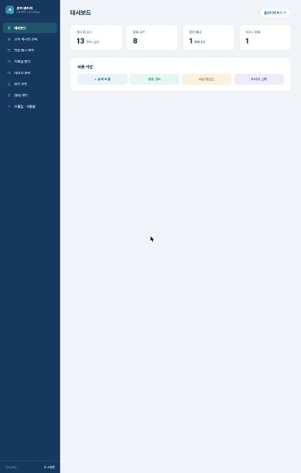
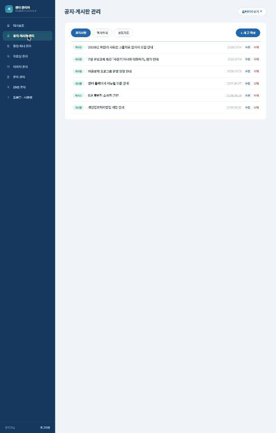
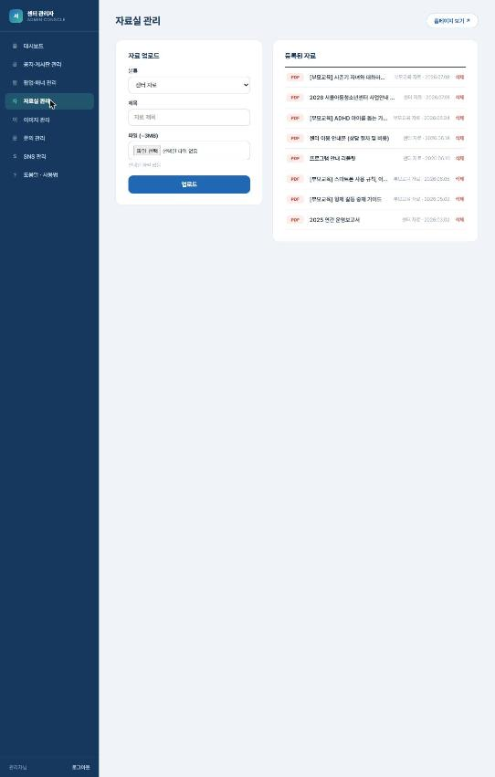
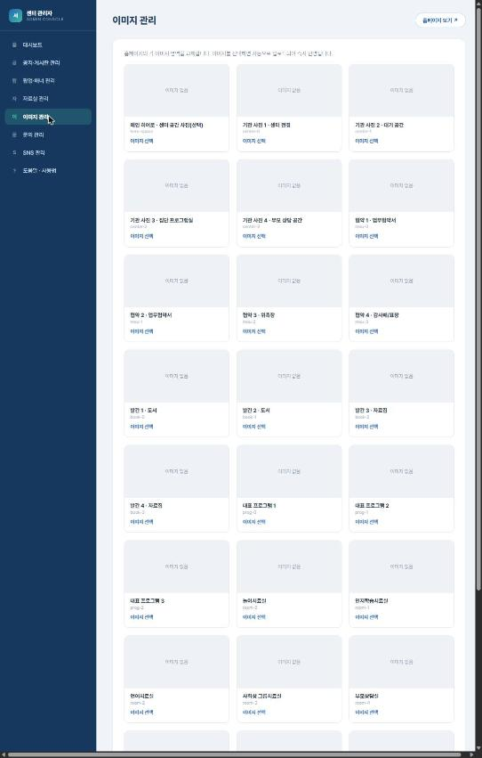
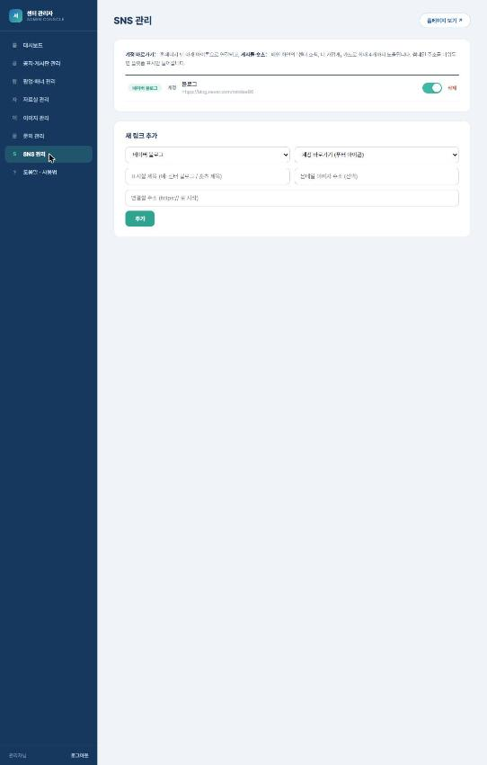
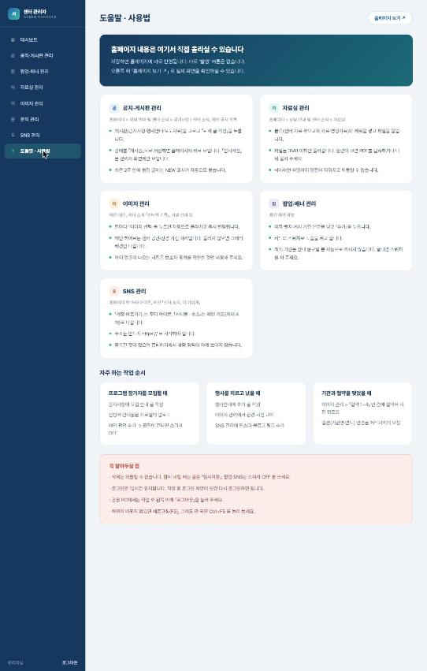

# 서울아동청소년센터 홈페이지 — 관리자 매뉴얼

센터에서 홈페이지 내용을 **직접 올리고 고치는 방법**입니다.
컴퓨터에 따로 설치할 프로그램은 없고, 인터넷 브라우저만 있으면 됩니다.

---

## 0. 한눈에 보기

| 무엇을 | 어디서 | 홈페이지 어디에 나오나 |
| --- | --- | --- |
| 공지·행사·보도자료 글 | 공지·게시판 관리 | 상담 안내 및 센터 소식 > 공지사항 / 센터 소식, 메인 공지 목록 |
| 자료 파일(PDF 등) | 자료실 관리 | 상담 안내 및 센터 소식 > 자료실 |
| 사진 교체 | 이미지 관리 | 메인 대문, 센터 소개, 시설 안내 등 |
| 자주 묻는 질문 | 자주 묻는 질문 | 상담 안내 및 센터 소식 > 자주 묻는 질문 |
| 메인 팝업·띠배너 | 팝업·배너 관리 | 메인 화면 팝업 |
| 블로그·인스타·유튜브 | SNS 관리 | 맨 아래 아이콘, 메인 「센터 소식, 더 가깝게」 |

**저장하면 홈페이지에 바로 반영됩니다.** 따로 "발행" 버튼은 없습니다.

---

## 1. 로그인

1. 브라우저 주소창에 **홈페이지 주소 뒤에 `/admin`** 을 붙여 들어갑니다.
   예) `www.센터주소.com/admin`
2. 비밀번호를 넣고 **로그인** 을 누릅니다.
3. 왼쪽에 메뉴가 있는 관리자 화면이 열립니다.

> - 로그인은 **12시간** 유지됩니다. 시간이 지나면 다시 로그인하면 됩니다.
> - 공용 PC에서는 작업 후 왼쪽 아래 **로그아웃** 을 눌러 주세요.
> - 오른쪽 위 **「홈페이지 보기 ↗」** 를 누르면 실제 화면을 새 창에서 확인할 수 있습니다.

---

## 2. 공지·게시판 관리 (글 올리기)

왼쪽 메뉴 **공지·게시판 관리**

### 새 글 쓰기

1. 위쪽에서 게시판을 고릅니다 — **공지사항 / 행사안내 / 보도자료**
2. 오른쪽 **+ 새 글 작성** 클릭
3. **제목**과 **내용**을 입력
4. 상태를 고릅니다
   - **게시중** → 홈페이지에 바로 보입니다
   - **임시저장** → 관리자 화면에만 보이고 홈페이지에는 나오지 않습니다 (작성 중인 글)
5. **저장** 클릭

### 고치기 · 지우기

목록에서 글 오른쪽의 **수정** 또는 **삭제** 를 누릅니다.
삭제는 확인창이 한 번 뜨고, **지우면 되돌릴 수 없습니다.**

### 어느 게시판이 어디에 나오나

| 게시판 | 홈페이지 위치 |
| --- | --- |
| 공지사항 | 상담 안내 및 센터 소식 > **공지사항**, 메인 화면 「공지사항」 목록(최신 5건) |
| 행사안내 | 상담 안내 및 센터 소식 > **센터 소식** 의 ‘행사안내’ 탭 |
| 보도자료 | 상담 안내 및 센터 소식 > **센터 소식** 의 ‘보도자료’ 탭 |

> 홈페이지에서 **제목을 누르면 글 본문이 열립니다.**

> 최근 2주 안에 올린 글에는 **NEW** 표시가 자동으로 붙습니다.

---

## 3. 자료실 관리 (파일 올리기)

왼쪽 메뉴 **자료실 관리**

1. **분류** 선택 — 센터 자료 / 부모교육 자료 / 영상자료
2. **제목** 입력 (홈페이지에 보일 이름)
3. **파일 선택** 후 **업로드** 클릭

> - 파일은 **3MB 이하**만 올라갑니다. PDF가 크면 "PDF 용량 줄이기"로 압축하거나 나눠서 올려 주세요.
> - 올린 파일은 홈페이지 자료실에서 **다운로드 버튼**으로 받을 수 있습니다.
> - 오른쪽 목록에서 **삭제** 를 누르면 파일까지 완전히 지워집니다. 되돌릴 수 없습니다.

---

## 4. 이미지 관리 (사진 교체)

왼쪽 메뉴 **이미지 관리**

사진이 들어갈 자리마다 칸이 하나씩 있습니다.
칸 아래 **「이미지 선택」** 을 누르고 사진 파일을 고르면 **자동으로 업로드되어 바로 반영**됩니다.
사진을 없애려면 **「비우기」** 를 누릅니다(파일까지 삭제되며 되돌릴 수 없습니다).

### 사진 자리 목록

| 칸 이름 | 홈페이지 위치 | 권장 |
| --- | --- | --- |
| 메인 히어로 · 센터 공간 사진 | 메인 대문 오른쪽 | 가로형, 1600×1000 전후. **올리지 않으면 그래픽 배경만 나옵니다** |
| 기관 사진 1~4 | 센터소개 > 센터 소개 > 「센터의 기록」 | 가로형 |
| 협약 1~4 | 〃 | 협약서·위촉장 스캔 |
| 발간 1~4 | 〃 | 도서 표지 |
| 놀이치료실 외 5개 | 센터소개 > 시설 안내 | 가로형 |
| 대표 프로그램 1~3 | 메인 「운영 중인 프로그램」 | 가로형 |
| 영상 썸네일 1~3 | 자료실 > 영상자료 | 가로형 |

> - 사진은 올릴 때 자동으로 줄여서 저장되므로 용량 걱정은 크게 하지 않으셔도 됩니다.
> - 아이 얼굴이 나오는 사진은 **보호자 동의**를 확인한 것만 사용해 주세요.
> - 센터 요청에 따라 **대문과 전문가 소개에는 인물 사진을 쓰지 않도록** 되어 있습니다.

---

## 5. 자주 묻는 질문 관리

왼쪽 메뉴 **자주 묻는 질문**

1. 아래 **새 질문 추가** 에서 **질문**과 **답변**을 입력하고 **추가**
2. 등록된 질문은 목록에 **Q / A** 로 표시됩니다
3. **수정** 을 누르면 아래 입력란에 내용이 채워지고, 고친 뒤 **수정 저장**
4. 필요 없는 질문은 **삭제**

> - 답변을 비워두고 질문만 먼저 등록해도 됩니다(홈페이지에는 질문만 보입니다).
> - 하나도 등록하지 않으면 홈페이지 FAQ 페이지에는 기본 질문 8개만 보입니다.

---

## 6. 팝업·배너 관리

왼쪽 메뉴 **팝업·배너 관리**

### 새로 만들기

1. **종류** 선택 — 메인 팝업 / 띠 배너
2. **제목**(팝업에 크게 나올 문구), **뱃지**(예: 모집 안내), **게시 기간**(예: 12.01 – 12.20), **본문 문구** 입력
3. **바로 게시(활성화)** 체크 후 **추가**

### 켜고 끄기

카드 오른쪽 위 **스위치**를 누르면 노출이 켜지고 꺼집니다.
행사가 끝나면 스위치를 끄거나 **삭제** 하시면 됩니다.

> - 메인 팝업은 방문자가 **「닫기」** 를 누르면 그 방문 동안 다시 뜨지 않습니다.
> - **게시 기간은 안내 문구일 뿐, 날짜가 지나도 자동으로 꺼지지 않습니다.** 기간이 끝나면 스위치를 꺼 주세요.

---

## 7. SNS 관리

왼쪽 메뉴 **SNS 관리**

### 계정 연결 (한 번만 해두면 됩니다)

1. **플랫폼** 선택 — 네이버 블로그 / 인스타그램 / 유튜브
2. **종류**를 **「계정 바로가기」** 로 선택
3. **표시할 제목**(예: 센터 블로그)과 **주소** 입력 → **추가**

→ 홈페이지 **맨 아래 아이콘**으로 연결됩니다.

### 소개할 게시물·숏츠 올리기

1. **종류**를 **「게시물 · 숏츠」** 로 선택
2. 제목, 주소, (있으면) 썸네일 이미지 주소 입력 → **추가**

→ 메인 화면 **「센터 소식, 더 가깝게」** 카드로 **최대 4개**까지 나옵니다.

> - 주소는 반드시 **`https://` 로 시작**해야 합니다.
> - **등록된 것이 하나도 없으면 홈페이지에 해당 영역이 아예 보이지 않습니다.** 빈 칸이 생기지 않도록 한 것입니다.
> - 스위치를 끄면 지우지 않고 잠시 숨길 수 있습니다.

---

## 8. 꼭 알아두실 점

- **삭제는 되돌릴 수 없습니다.** 글·파일·사진 모두 지우면 복구되지 않습니다. 잠시 내리고 싶을 때는
  글은 **임시저장**, 팝업·SNS는 **스위치 OFF** 를 쓰세요.
- **비밀번호는 센터 내부에서만 공유**해 주세요. 바꾸려면 제작자에게 요청하시면 됩니다.
- 화면이 바뀌지 않으면 **새로고침(F5)** 을 한 번 눌러 보세요.
- 모바일에서도 관리자 화면에 들어갈 수 있지만, **글쓰기와 사진 업로드는 PC가 편합니다.**

---

## 9. 이럴 때는

| 증상 | 확인할 것 |
| --- | --- |
| 로그인이 안 됨 | 비밀번호 확인. 그래도 안 되면 제작자에게 문의 |
| 작업 중 갑자기 로그인 화면이 뜸 | 로그인 유효시간(12시간) 만료. 다시 로그인하면 됩니다 |
| 파일 업로드 실패 | 파일이 3MB를 넘는지 확인 |
| 올린 글이 홈페이지에 안 보임 | 상태가 **임시저장** 으로 되어 있는지 확인 |
| 팝업이 계속 뜸 / 안 뜸 | 팝업·배너 관리에서 스위치 상태 확인 |
| 사진이 그대로 보임 | 새로고침(F5). 그래도 안 되면 Ctrl+F5 |

---

---

## 10. 관리자 화면 안에서도 볼 수 있습니다

왼쪽 메뉴 맨 아래 **「도움말 · 사용법」** 에 이 매뉴얼의 핵심 내용이 들어 있습니다.
작업하다 막히면 그 화면을 먼저 확인해 보세요.

---

문의: 홈페이지 제작 담당자
최종 수정일 2026-11-24
